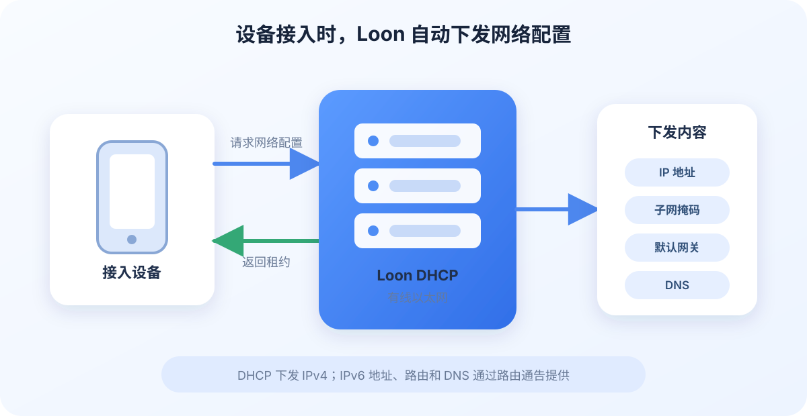

Loon4Mac（build 1007+）DHCP 负责在设备接入局域网时自动分配 IP 地址、子网掩码、默认网关和 DNS。Loon4Mac 可以在有线网络中提供独立的 DHCP 服务，并根据全局设置或单设备策略，决定设备是否使用 Loon 网关以及是否由 Loon 接管 UDP DNS。

<!-- truncate -->

## 开始之前

DHCP 会影响整个局域网中新接入和续租的设备。启用前请确认：

1. **Mac 已连接有线以太网。** Loon DHCP 不通过 Wi-Fi 接口提供服务。
2. **有线接口使用静态 IPv4。** 引导页会检测当前配置，并可将当前地址设置为静态地址。
3. **局域网中的其他 DHCP 服务器已经关闭。** 家用网络通常由路由器提供 DHCP，需要先在路由器管理页面中关闭。
4. **Loon VPN 已连接。** DHCP 服务运行在 Loon 网络扩展中。
5. **Mac 保持开机和清醒。** Mac 睡眠、网线断开或 VPN 停止后，Loon 无法继续响应设备的 DHCP 请求。

同一局域网中同时运行多个 DHCP 服务器时，设备可能从不同服务器取得相互冲突的配置，造成无法联网或流量没有经过预期网关。Loon 可以检测其他 DHCP 服务器并发出通知；还可以选择在发现其他服务器时自动停止 Loon DHCP。

## 通过引导开启 DHCP

1. 在 Loon4Mac 侧边栏进入 **网关**，选择 **DHCP**。
2. 打开 **启用 DHCP**，进入首次配置引导。
3. 选择连接局域网的以太网接口。
4. 检查接口是否使用静态 IPv4，并确认局域网中没有其他 DHCP 服务器。
5. 设置地址池、子网掩码、路由地址和 DNS。
6. 根据需要打开 **随着 VPN 启动**，然后完成配置。

启用成功后，让设备关闭再打开 Wi-Fi 或重新连接网线。设备会重新请求网络配置，并出现在 Loon 的在线设备列表中。使用 Loon DHCP 的设备会显示 DHCP 标记。

## 配置项说明

| 配置项 | 作用 |
| --- | --- |
| 起始地址、结束地址 | Loon 可以分配给设备的 IPv4 地址范围。地址池应与当前局域网处于同一子网，并避开路由器、Mac 和 Loon 网关使用的地址。 |
| 子网掩码 | 定义设备所在 IPv4 子网的范围，应与当前局域网配置一致。 |
| 路由地址 | 设备未使用 Loon 网关时使用的默认网关，通常填写局域网路由器地址。 |
| DNS 服务器 | 下发给设备的 DNS 地址；未启用 Loon UDP DNS 接管时，设备会直接使用这个地址。 |
| 租约时长 | 设备可以使用当前地址的时间。到期前，设备通常会自动续租。 |
| 默认使用 Loon 作为网关 | 让设备的网络流量通过 Loon，该项必须保持 Loon 网关开启。 |
| 接管 UDP DNS | Loon 接管设备的 UDP DNS，该项必须保持 Loon 网关开启。 |
| 发现其他 DHCP 时停止 | 运行中发现另一个 DHCP 服务器后，停止 Loon DHCP 并发出通知。 |
| 随着 VPN 启动 | 每次 Loon VPN 启动后，按当前配置自动启动 DHCP。 |

修改这些配置后，新接入设备和发起续租的设备会使用当前配置。Loon 会尽量为已有设备保留原来的 IP；未设置固定 IP 时，该地址在必要时仍可以分配给其他设备。

## 配合 Loon 网关使用

DHCP 和网关是两个独立功能，可以分别开启：

- 只开启 DHCP 时，Loon 可以分配地址，设备仍可使用局域网路由器作为默认网关。
- 同时开启 DHCP 和网关时，可以让全部设备或指定设备通过 Loon。
- “默认使用 Loon 作为网关”和“接管 UDP DNS”只修改后续下发的配置，不会立即改变设备当前已经取得的租约。设备需要重新接入网络或完成续租后才会应用。

如果为某个设备选择 **使用 Loon 网关**，且其 UDP DNS 策略仍为“跟随 DHCP 默认配置”，Loon 会同时为该设备启用 UDP DNS 接管并下发 Loon DNS。这样可以让域名规则正常工作。

## 单独管理设备

在设备列表中右键设备，可以设置：

- **网关策略：** 跟随 DHCP 默认配置、使用 Loon 网关或使用局域网网关。
- **UDP DNS 策略：** 跟随 DHCP 默认配置、由 Loon 接管或不接管。
- **IP 管理：** 使用自动 IP，或在地址池范围内为设备保留固定 IP。

策略按设备 MAC 地址保存，下次接入时继续生效。修改后需要让设备断开并重新加入局域网，或等待设备发起 DHCP 续租。

DHCP 页面还提供只读租约列表和地址保留管理。设备续租时，Loon 会优先继续分配原地址；设置固定 IP 后，该地址不会再分配给其他设备。

## DHCP 与 IPv6

Loon DHCP 当前提供的是 **DHCPv4**，地址池、子网掩码、路由地址和固定 IP 等配置都只针对 IPv4。Loon 不提供 DHCPv6，但这并不代表接入设备无法使用 IPv6。

设备的 IPv6 配置不通过 DHCPv6 下发，而是使用 **IPv6 RA（Router Advertisement，路由通告）**：

- **设备使用局域网网关：** IPv4 配置可以由 Loon DHCP 下发，IPv6 地址、路由和 DNS 继续由原有路由器提供。
- **设备使用 Loon 网关：** Loon IPv6 网关会在检测到可用 `/64` 前缀后，向该设备发送 IPv6 RA，提供 IPv6 路由和 Loon IPv6 DNS `fd27:712::3`。
- **只开启 Loon DHCP，没有开启 Loon 网关：** 设备仍可以从原有路由器取得 IPv6，但 IPv6 流量不会由 Loon 网关接管。

切换设备的网关或 UDP DNS 策略后，需要让设备重新接入网络。DHCP 续租负责更新 IPv4 配置；IPv6 路由和 DNS 则通过新的 IPv6 RA 更新。

如果上游网络没有提供可用的 IPv6 `/64` 前缀，设备仍可正常使用 Loon 分配的 IPv4 配置。Loon 不会为了缺少 IPv6 而停止 DHCPv4 服务。

## 关闭 DHCP 会有什么影响

- 手动设置静态 IP 的设备不会受到 DHCP 关闭的直接影响。
- 已取得租约的设备通常会在租约有效期内继续使用现有配置。
- 设备重新接入或租约需要续期时，如果局域网中没有其他 DHCP 服务器，就无法自动取得新的网络配置。
- 如果准备恢复路由器 DHCP，先确认它的地址池不会与 Loon 的固定地址和现有设备地址冲突，再让设备重新接入网络。

## 简单了解技术方案

Loon DHCP 运行在 Loon 的 macOS 网络扩展中，通过选中的有线接口接收设备的 DHCP 请求，再返回 IP、网关、DNS 和租约时长等配置。

租约和设备策略保存在独立数据库中，因此 Loon 重启后仍能识别已有设备，并尽量继续使用之前的地址。新设备和续租设备都会按当前 DHCP 配置生成响应。

当前 DHCP 服务提供 IPv4 地址分配，不提供 DHCPv6。IPv6 使用独立的 RA 流程，因此不会影响 Loon DHCP 对 IPv4 租约的管理。

## 常见问题

### 设备仍然拿到路由器分配的地址

局域网中很可能仍有另一个 DHCP 服务器。关闭路由器或其他设备上的 DHCP 服务，然后让客户端重新连接网络。也可以查看 Loon 的 DHCP 通知和运行状态。

### 修改配置后设备没有变化

DHCP 配置在设备下一次接入或续租时生效。断开设备网络后重新连接，通常可以立即取得新配置。

### DHCP 正在运行，但设备不能访问网络

检查地址池和子网掩码是否属于当前局域网。如果设备使用局域网网关，检查“路由地址”是否填写正确；如果设备使用 Loon 网关，检查 Loon 网关是否正在运行，并确认 DNS 策略与网关策略匹配。

