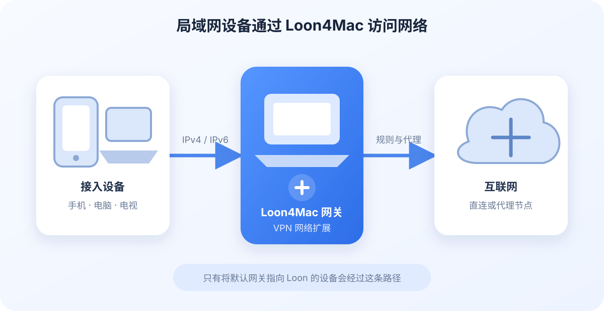

Loon4Mac（build 1007+） 的网关功能可以让同一局域网内的手机、平板、电脑和其他设备通过 Mac 上的 Loon 访问网络。接入设备不需要安装 Loon，只要把默认网关指向 Loon 提供的网关地址，就能使用 Loon 的分流规则、策略和代理节点。

<!-- truncate -->

## 适合哪些场景

- 临时让手机、电视、游戏机或另一台电脑使用 Loon。
- 接入设备无法安装代理软件，但支持修改 IP、网关和 DNS。
- 希望在 Mac 上集中查看设备状态、请求数量和流量。
- 配合 Loon DHCP，自动给不同设备下发网关和 DNS 策略。

## 开始之前

使用网关前，请先确认以下条件：

1. **Mac 已连接有线以太网。** 当前网关通过有线接口接入局域网，暂不支持使用 Wi-Fi 接口提供网关服务。
2. **Loon VPN 已连接。** 网关运行在 Loon 的网络扩展中，VPN 未连接时无法转发设备流量。
3. **Mac 不会在使用期间进入睡眠。** Mac 睡眠、网线断开或 VPN 停止后，正在使用 Loon 网关的设备会失去网络连接。
4. **网关 IP 没有被其他设备占用。** 自动配置会选择可用接口和地址；手动填写时，应使用当前局域网网段内尚未占用的地址。
5. **没有同时使用其他虚拟机软件的桥接模式。** Loon 网关使用 VM 桥接模式，无法与 Parallels Desktop、VMware Fusion 等虚拟机软件的桥接模式同时运行。

建议让 Mac 的有线接口长期使用一个稳定的 IPv4 地址。仅使用网关时这不是强制要求；如果还要启用 Loon DHCP，则有线接口必须使用静态 IPv4。

## 开启网关

1. 将 Mac 接入有线局域网并连接 Loon VPN。
2. 在 Loon4Mac 侧边栏进入 **网关**，选择 **网关配置**。
3. 选择用于接入局域网的以太网接口。
4. 使用自动配置，或填写一个未被占用的网关 IP。
5. 打开 **启动网关**。

如果希望每次连接 Loon VPN 后自动恢复网关，可以打开 **随着 VPN 启动**。这个选项只决定启动行为；页面上的“启动网关”开关显示并控制当前运行状态。

当接口不可用、地址冲突或配置不完整时，页面会显示启动失败原因。由网线断开、接口暂时消失等情况造成的中断，在接口恢复且满足启动条件后，Loon 会尝试恢复网关。

## 让设备接入

有两种方式可以让设备使用 Loon 网关。

### 手动配置

在设备的网络设置中保留当前网段，按下面的方式填写：

- **IP 地址：** 当前局域网中未被占用的地址。
- **子网掩码：** 与局域网现有配置一致。
- **路由器或默认网关：** Loon 网关页面显示的网关 IP。
- **DNS：** 根据下面的 DNS 说明选择。

### 使用 Loon DHCP

启用 Loon DHCP 后，可以由 Loon 自动下发 IP、网关和 DNS。DHCP 支持全局默认配置，也可以为单个设备指定使用 Loon 网关、接管 UDP DNS 或保留固定 IP。详细步骤请参阅 [使用 Loon4Mac 提供 DHCP 服务](/blog/loon4mac-dhcp)。

## DNS 应该怎么设置

DNS 会影响域名请求是否能完整使用 Loon 的规则和 Fake-IP 能力。

| DNS 设置 | 数据路径和适用情况 |
| --- | --- |
| `198.19.0.3` | 使用 Loon 的 Fake-IP DNS，适合需要按域名规则分流的设备。 |
| 路由器 DNS，例如 `192.168.2.1` | DNS 通常由路由器处理；未开启 UDP DNS 接管时，Loon 可能无法获得完整的域名信息。 |
| 公共 DNS，例如 `223.5.5.5` | DNS 请求直接发往公共 DNS；未开启 UDP DNS 接管时，不会使用 Loon 的 Fake-IP DNS。 |

如果设备已经使用 Loon 网关，推荐同时让 Loon 接管 UDP DNS。使用 Loon DHCP 时，可以在默认配置或单设备策略中完成设置。

## 支持的功能

- IPv4 网关转发和 Loon 规则、策略、节点处理。
- IPv6 TCP、UDP 和 ICMPv6 转发，以及 Loon IPv6 DNS。
- 在线与离线设备列表，以及设备名称、IP、MAC 地址和设备图标。
- 单设备请求数量、当前连接数、上传流量和下载流量统计。
- 设备连接历史和流量记录。
- 配合 Loon DHCP 设置单设备网关策略、UDP DNS 策略和固定 IP。
- 网关启动失败、运行中断和设备接入等通知。

设备名称和类型来自设备主动提供的信息及局域网发现结果。部分设备不会公开完整名称，因此可能显示通用名称或未知设备图标。

## IPv6 网关

IPv6 网关会随 Loon 网关自动工作，不需要单独开启。只要有线网络提供可用的 IPv6 `/64` 前缀，使用 Loon 网关的设备就能自动取得 IPv6 路由和 DNS，IPv6 流量也会使用 Loon 的规则、策略和代理节点。

客户端通常不需要手动配置 IPv6。开启网关后重新连接网络即可；如果当前网络不支持 IPv6，IPv4 网关仍可正常使用。Loon DHCP 只负责 IPv4 配置，不提供 DHCPv6。

## 简单了解技术方案

Loon4Mac 使用 macOS 的 VMNET 能力，把选中的以太网接口接入 Loon 网络扩展。IPv4 设备通过 ARP 找到 Loon 网关；IPv6 设备通过路由通告和邻居发现找到 Loon。设备将数据发送给 Loon 网关后，流量进入 Loon 原有的规则和代理处理流程，再由 Mac 转发到目标网络。

只有把默认网关指向 Loon 的设备才会经过这条路径。局域网内其他设备以及设备之间的普通本地通信不会因为开启网关而自动改道。

## 常见问题

### 开启后设备没有网络

依次检查 Loon VPN 是否已连接、Mac 是否仍连接网线、设备默认网关是否填写为 Loon 网关 IP，以及该 IP 是否与其他设备冲突。若能访问 IP 地址但不能打开域名，再检查设备的 DNS 设置。

### 可以通过 Wi-Fi 提供网关吗

当前版本要求使用有线以太网接口。Mac 自己可以同时连接 Wi-Fi，但不能选择 Wi-Fi 接口作为 Loon 网关的局域网接入口。

### 关闭网关会发生什么

正在使用 Loon 网关的设备会立即失去这条转发路径。把设备的默认网关改回局域网路由器，或让设备重新从其他 DHCP 服务器获取配置后，即可恢复普通局域网连接。

