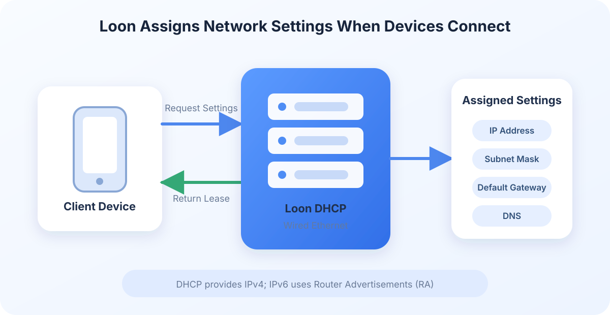

Loon4Mac DHCP (Build 1007+) automatically assigns IP addresses, subnet masks, default gateways, and DNS settings when devices join the LAN. Loon4Mac can provide an independent DHCP service on a wired network and use global or per-device policies to decide whether each device uses the Loon gateway and whether Loon intercepts its UDP DNS traffic.

<!-- truncate -->

## Before you begin

DHCP affects new devices and devices renewing their leases across the LAN. Check the following before enabling it:

1. **Your Mac is connected through wired Ethernet.** Loon DHCP does not provide service through a Wi-Fi interface.
2. **The Ethernet interface uses a static IPv4 address.** The setup wizard checks the current configuration and can make the current address static.
3. **Other DHCP servers on the LAN are disabled.** Home routers normally provide DHCP, so disable that service in the router's administration page first.
4. **Loon VPN is connected.** DHCP runs inside Loon's network extension.
5. **Your Mac remains powered on and awake.** Loon cannot respond to DHCP requests if the Mac sleeps, Ethernet disconnects, or the VPN stops.

When multiple DHCP servers run on the same LAN, devices may receive conflicting settings and either lose connectivity or bypass the intended gateway. Loon can detect other DHCP servers and notify you. It can also stop Loon DHCP automatically when another server is discovered.

## Enable DHCP with the setup wizard

1. Open **Gateway** in the Loon4Mac sidebar and select **DHCP**.
2. Turn on **Enable DHCP** to open the initial setup wizard.
3. Select the Ethernet interface connected to the LAN.
4. Confirm that the interface uses a static IPv4 address and that no other DHCP server is running on the LAN.
5. Configure the address pool, subnet mask, router address, and DNS.
6. Enable **Start with VPN** if needed, then complete the setup.

After DHCP starts successfully, turn the device's Wi-Fi off and on or reconnect its Ethernet cable. The device requests new network settings and appears in Loon's online device list. Devices using Loon DHCP display a DHCP badge.

## Configuration options

| Option | Purpose |
| --- | --- |
| Start and end addresses | The IPv4 address range Loon can assign. It must be in the current LAN subnet and exclude addresses used by the router, the Mac, and the Loon gateway. |
| Subnet mask | Defines the IPv4 subnet and should match the current LAN configuration. |
| Router address | The default gateway used when a device does not use the Loon gateway. This is normally the LAN router's address. |
| DNS server | The DNS address assigned to devices. When Loon UDP DNS interception is disabled, devices query this address directly. |
| Lease duration | How long a device may use its current address. Devices normally renew before the lease expires. |
| Use Loon as the default gateway | Routes device traffic through Loon. The Loon gateway must remain enabled. |
| Intercept UDP DNS | Lets Loon intercept the device's UDP DNS traffic. The Loon gateway must remain enabled. |
| Stop when another DHCP server is found | Stops Loon DHCP and sends a notification when another DHCP server is detected. |
| Start with VPN | Starts DHCP with the current configuration whenever Loon VPN starts. |

After these options change, new devices and devices renewing their leases receive the current configuration. Loon tries to preserve existing addresses, but an address that is not reserved may still be assigned to another device when necessary.

## Use DHCP with the Loon gateway

DHCP and the gateway are independent features and can be enabled separately:

- With DHCP only, Loon can assign addresses while devices continue using the LAN router as their default gateway.
- With DHCP and the gateway enabled, all devices or selected devices can be routed through Loon.
- **Use Loon as the default gateway** and **Intercept UDP DNS** affect future DHCP responses. They do not immediately replace settings in an active lease, so the device must reconnect or renew its lease.

If a device is set to **Use Loon Gateway** while its UDP DNS policy still follows the DHCP default, Loon also enables UDP DNS interception and assigns Loon DNS to that device. This allows domain-based rules to work correctly.

## Manage individual devices

Right-click a device in the device list to configure:

- **Gateway policy:** Follow the DHCP default, use the Loon gateway, or use the LAN gateway.
- **UDP DNS policy:** Follow the DHCP default, let Loon intercept it, or do not intercept it.
- **IP management:** Use an automatic IP or reserve a fixed address within the pool.

Policies are stored by MAC address and remain in effect the next time the device joins. After changing a policy, reconnect the device or wait for it to renew its DHCP lease.

The DHCP page also provides a read-only lease list and address reservation management. Loon prefers to renew a device with its existing address. Once an address is reserved, it is no longer assigned to other devices.

## DHCP and IPv6

Loon DHCP currently provides **DHCPv4**. The address pool, subnet mask, router address, and reserved IP settings apply only to IPv4. Loon does not provide DHCPv6, but connected devices can still use IPv6.

IPv6 configuration is delivered through **IPv6 RA (Router Advertisement)** rather than DHCPv6:

- **Device uses the LAN gateway:** Loon DHCP can provide the IPv4 configuration, while the existing router continues to provide the IPv6 address, route, and DNS.
- **Device uses the Loon gateway:** After detecting a usable `/64` prefix, the Loon IPv6 gateway sends IPv6 RA to that device with an IPv6 route and Loon IPv6 DNS at `fd27:712::3`.
- **Loon DHCP is enabled without the Loon gateway:** The device can still obtain IPv6 configuration from the existing router, but its IPv6 traffic is not handled by the Loon gateway.

After changing a device's gateway or UDP DNS policy, reconnect it to the network. DHCP renewal updates its IPv4 configuration, while a new IPv6 RA updates its IPv6 route and DNS.

If the upstream network does not provide a usable IPv6 `/64` prefix, devices can still use the IPv4 settings assigned by Loon. The absence of IPv6 does not stop DHCPv4.

## What happens when DHCP is disabled?

- Devices with manually configured static IP addresses are not directly affected.
- Devices with active leases normally continue using their existing settings until the leases expire.
- If no other DHCP server is available, devices cannot obtain new settings when they reconnect or renew their leases.
- Before restoring the router's DHCP service, confirm that its address pool does not conflict with Loon's reserved addresses or addresses currently in use, then reconnect the devices.

## Technical overview

Loon DHCP runs inside Loon's macOS network extension. It receives DHCP requests through the selected Ethernet interface and responds with the IP address, gateway, DNS server, and lease duration.

Leases and device policies are stored in a separate database, allowing Loon to recognize existing devices after a restart and preserve their previous addresses when possible. New devices and renewing devices receive responses based on the current DHCP configuration.

The DHCP service assigns IPv4 addresses and does not provide DHCPv6. IPv6 uses a separate RA flow and does not affect Loon DHCP's management of IPv4 leases.

## FAQ

### A device still receives an address from the router

Another DHCP server is probably still running on the LAN. Disable DHCP on the router or other device, then reconnect the client. You can also check Loon's DHCP notifications and running status.

### A device did not change after the configuration was updated

DHCP changes take effect when a device next joins the network or renews its lease. Disconnecting and reconnecting the device normally applies the new configuration immediately.

### DHCP is running, but a device cannot access the network

Check that the address pool and subnet mask belong to the current LAN. If the device uses the LAN gateway, verify the **Router Address**. If it uses the Loon gateway, check that the Loon gateway is running and that the DNS policy matches the gateway policy.
