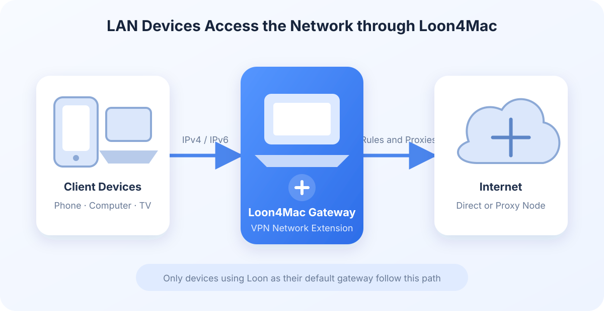

The gateway feature in Loon4Mac (Build 1007+) lets phones, tablets, computers, and other devices on the same LAN access the network through Loon on your Mac. Client devices do not need Loon installed. Point their default gateway to the address provided by Loon to use Loon's routing rules, policies, and proxy nodes.

<!-- truncate -->

## When to use it

- Temporarily route a phone, TV, game console, or another computer through Loon.
- Connect a device that cannot run proxy software but supports manual IP, gateway, and DNS settings.
- View device status, request counts, and traffic centrally on your Mac.
- Use Loon DHCP to assign gateway and DNS policies to individual devices automatically.

## Before you begin

Check the following requirements before enabling the gateway:

1. **Your Mac is connected through wired Ethernet.** The gateway currently uses a wired interface to join the LAN and cannot provide gateway service through Wi-Fi.
2. **Loon VPN is connected.** The gateway runs inside Loon's network extension and cannot forward device traffic while the VPN is disconnected.
3. **Your Mac will remain awake.** Devices using the Loon gateway lose connectivity if the Mac sleeps, Ethernet disconnects, or the VPN stops.
4. **The gateway IP is not used by another device.** Automatic configuration selects an available interface and address. For manual configuration, choose an unused address in the current LAN subnet.
5. **No other virtualization software is using bridged networking.** The Loon gateway uses VM bridged networking and cannot run alongside bridged mode in software such as Parallels Desktop or VMware Fusion.

For long-term use, assign a stable IPv4 address to the Mac's Ethernet interface. This is optional when using only the gateway, but a static IPv4 address is required when Loon DHCP is also enabled.

## Enable the gateway

1. Connect the Mac to the wired LAN and connect Loon VPN.
2. Open **Gateway** in the Loon4Mac sidebar and select **Gateway Configuration**.
3. Select the Ethernet interface connected to the LAN.
4. Use automatic configuration or enter an unused gateway IP.
5. Turn on **Start Gateway**.

To restore the gateway automatically whenever Loon VPN connects, enable **Start with VPN**. This option controls startup behavior only; the **Start Gateway** switch displays and controls the current running state.

If the interface is unavailable, the address is already in use, or the configuration is incomplete, the page displays the reason startup failed. When an interruption is caused by a disconnected cable or temporarily unavailable interface, Loon attempts to restore the gateway after the interface returns and all startup requirements are met.

## Connect a device

There are two ways to connect devices to the Loon gateway.

### Manual configuration

Keep the device on the current subnet and enter the following values in its network settings:

- **IP address:** An unused address on the current LAN.
- **Subnet mask:** The same mask used by the existing LAN.
- **Router or default gateway:** The gateway IP displayed on the Loon gateway page.
- **DNS:** Choose an option from the DNS section below.

### Loon DHCP

When Loon DHCP is enabled, it can assign the IP address, gateway, and DNS automatically. DHCP supports global defaults and per-device settings for the Loon gateway, UDP DNS interception, and reserved IP addresses. See the [Loon4Mac DHCP Guide](/en/blog/loon4mac-dhcp) for detailed instructions.

## Choosing a DNS setting

The DNS setting determines whether domain requests can fully use Loon's routing rules and Fake-IP features.

| DNS setting | Path and use case |
| --- | --- |
| `198.19.0.3` | Uses Loon's Fake-IP DNS and is suitable for devices that need domain-based routing rules. |
| Router DNS, such as `192.168.2.1` | DNS is normally handled by the router. Without UDP DNS interception, Loon may not receive complete domain information. |
| Public DNS, such as `223.5.5.5` | Queries go directly to the public DNS server. Without UDP DNS interception, the device does not use Loon's Fake-IP DNS. |

If a device already uses the Loon gateway, enabling Loon UDP DNS interception is recommended. With Loon DHCP, this can be configured globally or as a per-device policy.

## Supported features

- IPv4 gateway forwarding through Loon rules, policies, and nodes.
- IPv6 TCP, UDP, and ICMPv6 forwarding, plus Loon IPv6 DNS.
- Online and offline device lists with names, IP addresses, MAC addresses, and device icons.
- Per-device request counts, active connections, upload traffic, and download traffic.
- Device connection history and traffic records.
- Per-device gateway policies, UDP DNS policies, and reserved IP addresses through Loon DHCP.
- Notifications for startup failures, service interruptions, and newly connected devices.

Device names and types come from information announced by each device and from LAN discovery. Some devices do not expose a complete name and may appear with a generic name or an unknown-device icon.

## IPv6 gateway

The IPv6 gateway works automatically with the Loon gateway and does not need a separate switch. When the wired network provides a usable IPv6 `/64` prefix, devices using the Loon gateway automatically receive IPv6 routing and DNS information. Their IPv6 traffic uses the same Loon rules, policies, and proxy nodes.

Clients normally require no manual IPv6 configuration. Reconnect the device after enabling the gateway. If the current network does not support IPv6, the IPv4 gateway continues to work normally. Loon DHCP handles IPv4 configuration only and does not provide DHCPv6.

## Technical overview

Loon4Mac uses macOS VMNET to attach the selected Ethernet interface to the Loon network extension. IPv4 devices locate the Loon gateway through ARP, while IPv6 devices use Router Advertisements and Neighbor Discovery. Traffic sent to the Loon gateway enters Loon's existing rule and proxy processing flow before the Mac forwards it to the destination network.

Only devices whose default gateway points to Loon use this path. Other devices on the LAN and ordinary local communication between devices are not automatically rerouted when the gateway is enabled.

## FAQ

### A device has no network access after enabling the gateway

Check that Loon VPN is connected, the Mac is still connected through Ethernet, the device's default gateway is set to the Loon gateway IP, and that the address is not used by another device. If IP addresses are reachable but domain names are not, check the device's DNS settings.

### Can the gateway use Wi-Fi?

The current version requires a wired Ethernet interface. The Mac itself can remain connected to Wi-Fi, but Wi-Fi cannot be selected as the LAN-facing interface for the Loon gateway.

### What happens when the gateway is disabled?

Devices using the Loon gateway immediately lose that forwarding path. Set their default gateway back to the LAN router, or let them obtain new settings from another DHCP server, to restore normal LAN connectivity.
